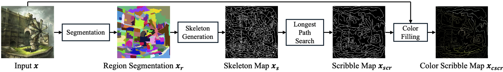

# DetFill-with-DHT: Deterministic Hints and Hint-AUC for Line Art Colorization

[](https://doi.org/10.1109/TVCG.2026.3738401)
[](https://doi.org/10.1109/TVCG.2026.3738401)
[](https://doi.org/10.5281/zenodo.22995102)
[](LICENSE)
[](docs/setup.md)
[](docs/setup.md)
[](https://pypi.org/project/hintauc/)
[](https://github.com/MADONOKOUKI/DetFill-with-DHT/releases)
[](https://github.com/MADONOKOUKI/DetFill-with-DHT/actions/workflows/tests.yml)

Official implementation of **"Hint-AUC: Deterministic Region-based Hint Generation for Line Art Colorization
Evaluation"**, IEEE Transactions on Visualization and Computer Graphics (TVCG), 2026.

[Koki Madono](https://madonokouki.github.io/) · [Yuan Mingcheng](https://esslab.jp/en/members/) · [Edgar Simo-Serra](https://esslab.jp/~ess/) — Waseda University

[Paper](https://doi.org/10.1109/TVCG.2026.3738401) · [Library on PyPI](https://pypi.org/project/hintauc/) · [Checkpoints and data](https://github.com/MADONOKOUKI/DetFill-with-DHT/releases) · [Documentation](https://madonokouki.github.io/projects/hintauc/docs/)



**DHT** turns an illustration into fixed scribble and dot hints, **Hint-AUC** scores a colorization model over the whole
range of hint ratios, and **DetFill** is the diffusion colorization model trained with these hints; the paper's
checkpoints, evaluation inputs, metric files and experiment scripts are released.

<details markdown="1">
<summary>Why deterministic hints, what is released, and what is exact</summary>

Hint-based line art colorization is usually evaluated with random colour hints, so scores change from run to run.
DHT derives the hints from the regions of the illustration (one scribble and one dot per region, largest regions
first as the hint ratio grows); Hint-AUC integrates a metric over hint ratios from no hints to fully hinted; DetFill is
a pixel-space diffusion model conditioned on line art and these hints. The
[coverage table](reproduce/README.md#coverage-what-each-paper-item-needs) says which paper items are rebuilt
exactly from the released per-ratio metrics, which are re-run from the checkpoints, and which are not provided. The
stored hint maps are the reference for every printed number: regeneration with the paper's FilFinder path can move a
few pixels between runs, the `geodesic` path is bit-reproducible
([details](docs/detail_explanation.md#what-is-exact-and-what-is-not)).

</details>

## Getting started

- **Demo, no data** — `pip install hintauc && hintauc demo` (about 10 s; the numbers are checked in CI).
- **Quick start on CPU** — `python examples/quickstart_cpu.py` (`--fast`: under a minute); expected numbers in the script header.
- **Evaluate your own model** — [docs/evaluate_your_model.md](docs/evaluate_your_model.md): images per ratio (`hintauc curve`) or a Python function (`hintauc.evaluate_colorizer`).
- **Install** — [docs/setup.md](docs/setup.md).
- **Model zoo** — [checkpoints/README.md](checkpoints/README.md): every released file, its hash and its paper item.
- **Reproduce the paper** — [reproduce/README.md](reproduce/README.md): Fig. 9 in one command, tables from the released metrics, the example suite, full table rows, training; a coverage table per paper item.
- **Replicability Stamp** — `bash replicability/run.sh` ([replicability/README.md](replicability/README.md), [submission sheet](replicability/GRSI_SUBMISSION.txt)).
- **Reference** — [API](docs/api.md) · [added features since the paper](docs/added_features.md) · [how it works](docs/detail_explanation.md).

## Quick start

```bash
pip install hintauc            # "hintauc[paper]" adds torchvision + torchmetrics 1.4.0, the paper's metric backend
hintauc demo                   # synthetic illustration -> hints -> oracle colorizer at 8 ratios -> Hint-AUC
```

```python
import hintauc

hints = hintauc.generate_hints("illustration.png", size=64)        # paper hint resolution; see below
color, mask = hints.at_ratio(0.10, hint_type="scribble")           # hints of the largest 10 % of the regions
hints.save("out/illustration")                                     # files in the DetFill data layout

evaluator = hintauc.Evaluator(metrics=("psnr", "lpips", "dreamsim"))  # lpips / dreamsim: pip install "hintauc[perceptual]"
print(evaluator("colorized.png", "ground_truth.png"))              # the paper's metrics
```

- Command line: `hintauc generate image.png --ratio 0.1`, `hintauc eval pred_dir gt_dir --metrics mse psnr ssim`,
  `hintauc curve pred_root gt_dir` (Hint-AUC from one directory of outputs per ratio), `hintauc demo`.
- DetFill inference over the ratio grid: `cd detfill && GPU=0 bash run_inference.sh scribble`
  ([detfill/README.md](detfill/README.md)).
- Fig. 9 from a fresh checkout: `bash replicability/run.sh` (3 minutes on a GPU after a one-time setup of 10–20 minutes).

## Choosing the hint resolution

**DHT does not require reducing the input's width and height to one quarter.** Keep these three resolutions separate:

- **Segmentation input:** `generate_hints` segments the image at the resolution you supply.
- **Hint generation:** `size` sets the hint grid: the input image and region map are resized to this grid before
  skeletons, scribbles and region-mean colours are computed. Its default is `64`, matching the paper's released hint maps.
- **Model input:** hints may then be resized to the resolution expected by the colorization model.

For fair comparison with existing methods, the paper generates **64 × 64 hints** and upsamples them with
nearest-neighbour interpolation to **256 × 256** when required, including for DetFill
([main paper, Sec. VI-A](https://madonokouki.github.io/papers/madono2026-hintauc.pdf#page=8)).
This is the paper's experimental setting, not a required step of DHT. In particular, a 512 × 512 input does **not**
require generating hints at 128 × 128. The [supplementary material, Sec. II-B, “Influence of Hint Resolution”](https://madonokouki.github.io/papers/madono2026-hintauc-supp.pdf#page=3)
compares models trained with 64 × 64 and 256 × 256 hints and shows finer details with the higher-resolution hints.

To segment a **512 × 512 input** and generate scribbles at that same resolution, set `size=512` explicitly:

```python
import hintauc

hints = hintauc.generate_hints("image_512.png", size=512)  # image_512.png is already 512 × 512
color, mask = hints.at_ratio(0.10, hint_type="scribble")   # 512 × 512 hints; no 128 × 128 intermediate
```

Setting `at_ratio(..., resize_to=512)` alone only resizes previously generated hints; it does not extract scribbles
at 512 × 512. Choose `size` during generation. Higher-resolution generation avoids this downsampling step, but each
scribble still uses its region's mean colour; it does not preserve every within-region colour variation.

For paper reproduction, keep the released maps and original resolution settings. For a new task, choose the hint
resolution for that task and use it consistently in training and evaluation. See the [API reference](docs/api.md)
and [pipeline details](docs/detail_explanation.md#pipeline).

## Repository structure

```
hintauc/           the library (hints, metrics, Hint-AUC, evaluation, CLI)
detfill/           the DetFill model: training, inference, configs (BBDM fork)
reproduce/         reproduction package: scripts, example suite, released metrics, data, paper launchers
replicability/     one-command Fig. 9 (Replicability Stamp entry point)
checkpoints/       model zoo
hint_generation/   original hint-generation scripts
evaluation/        original evaluation scripts
docs/              documentation
assets/            images
```

## License

MIT License ([LICENSE](LICENSE)); third-party components in [THIRD_PARTY_NOTICES.md](THIRD_PARTY_NOTICES.md).
`detfill/` is built on [BBDM](https://github.com/xuekt98/BBDM) (MIT). The Danbooru2021 illustrations are not
redistributed except the nine that appear in the paper's figures (listed there, non-commercial research use only);
all other images are fetched by id from Danbooru with `reproduce/scripts/fetch_originals.py`.

## Contributing

Contributions are welcome. See [contributing](CONTRIBUTING.md) and the [code of conduct](CODE_OF_CONDUCT.md).

## Citing

GitHub's "Cite this repository" button uses `CITATION.cff`; the BibTeX entry:

```bibtex
@article{madono2026hintauc,
  title   = {Hint-AUC: Deterministic Region-based Hint Generation for Line Art Colorization Evaluation},
  author  = {Madono, Koki and Mingcheng, Yuan and Simo-Serra, Edgar},
  journal = {IEEE Transactions on Visualization and Computer Graphics},
  year    = {2026},
  doi     = {10.1109/TVCG.2026.3738401}
}
```

The repository state reviewed for the Graphics Replicability Stamp (tag `grsi-1.0`) is archived at Zenodo, DOI [10.5281/zenodo.22995102](https://doi.org/10.5281/zenodo.22995102) (all versions; this version: [10.5281/zenodo.22995103](https://doi.org/10.5281/zenodo.22995103)).
